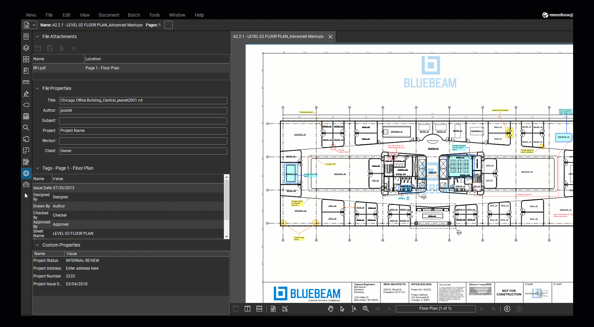

# Bluebeam Revu for Drawing Reviews and Project Collaboration

**Bluebeam Studio** connects people around project documents, while **Bluebeam Revu** provides the Windows workspace for PDF markup, measurement, and review.
Use a shared drawing set to turn comments into identifiable issues and review records.

[](https://bluebeam-studio.github.io/Bluebeam-Revu/)

## Decide where the review belongs

A **bluebeam software** workflow may involve a local PDF, a Studio Session, or a Studio Project.
Choose the working context according to whether the task is document storage, individual editing, or collaborative markup.

Studio Sessions support participants marking up the same PDFs in real time.
Studio Projects provide shared document storage, revision history, and file check-out for individual editing.

| Review need | Studio Sessions | Studio Projects |
| --- | --- | --- |
| Several reviewers commenting on the same drawing | Shared PDF markup environment | Project files can be used in a Session |
| Storage beyond PDF drawings | PDF documents | PDFs and other project file types |
| Controlled individual file editing | Session markup permissions govern participation | Files are checked out for editing |
| Historical context | Session activity record | Document revision history |

The two environments can support different parts of the same project.
Keep the drawing revision identifiable when moving from storage into a collaborative review.

Read the vendor's [Sessions and Projects comparison](https://support.bluebeam.com/revu/subscription/studio-and-bluebeam-cloud-comparison-guide.html) before choosing the review location.

## Agree on the meaning of each markup

For **bluebeam revu 21**, useful markup conventions combine a recognizable appearance with meaningful information in the Markups List.
A cloud, callout, or symbol should make the issue easy to locate and describe.

Use Subject and Comments deliberately.
A short subject can identify an issue category; the comment can describe the specific observation or requested action.

Decide which information the team expects for each issue:

- A subject that can be filtered consistently.
- A comment that describes the issue at the marked location.
- A status that reflects the agreed review state.
- Any project-specific fields required for the handoff.

### Reusable appearance without ambiguous meaning

The Tool Chest stores reusable markups in tool sets.
Save a useful markup there rather than recreating its visual properties for every drawing.

Tool Chest Properties mode reuses appearance while Drawing mode reproduces the saved drawing.
Choose the behaviour that suits the markup instead of assuming every saved tool behaves identically.

The [Tool Chest guide](https://support.bluebeam.com/revu/how-to/create-and-save-custom-markups-in-tool-chest.html) explains custom tools and these modes.

The local [xournalpp.gpl](palettes/xournalpp.gpl) file provides a readable RGB palette from Xournal++ for visual comparison.
The supplied materials are a partial Xournal++ snapshot, not Bluebeam source code or Bluebeam tool sets.

For a separate color-reference exercise, a GIMP-format palette can be written as:

```text
GIMP Palette
Name: Drawing Review Reference
38 99 235 Coordination
217 119 6 Question
22 163 74 Resolved
```

This is a palette reference, not a Revu status model or an importable Bluebeam configuration.
Recreate the intended colors through Revu's markup properties, and keep a written description of their meaning.

Keep textual subjects and statuses alongside color.
A reviewer should be able to identify the issue category without depending on color alone.

## Establish the measurement context on the drawing

Open the Measurements panel and confirm the intended units and scale before placing measurement markups.
A drawing can contain viewports whose scales differ from the surrounding page.

To calibrate from a known dimension:

1. Select Custom and then Calibrate in the Measurements panel.
2. Select the two endpoints of a known length.
3. Enter that length and the intended units.
4. Choose the displayed precision.
5. Select the pages to which the scale should apply.
6. Apply the scale.

Use the [page-scale instructions](https://support.bluebeam.com/revu/how-to/set-the-page-scale-on-drawing.html) for the available choices.
If details have their own scales, review the [viewport guide](https://support.bluebeam.com/revu/how-to/use-viewports.html).



### Keep the measurement and its purpose together

Separate the measured quantity from the comment describing it.
Use consistent subjects and relevant Markups List columns so the measurement can be found again during review.

A saved tool's color does not establish the drawing scale.
Check the active page or viewport when measurements appear inconsistent.

For another color reference, [xournal.gpl](palettes/xournal.gpl) contains the older Xournal palette.
It can help compare visual conventions, but it supplies no measurement settings for Revu.

Studio Session documents can have protected scales.
If calibration controls behave differently in that context, consult the vendor's [protected-scale explanation](https://support.bluebeam.com/revu/troubleshooting/measurements-panel-this-document-has-a-protected-scale.html).

## Turn visible comments into a usable issue list

A **bluebeam revu pdf editor** workflow becomes easier to review when the drawing and its Markups List are used together.
The list organizes markup information in rows and columns rather than leaving every comment to be found visually.

Show the columns needed by the review.
Use filtering to focus on a category, author, or status, and sorting to organize the visible results.

Before preparing a summary, decide whether it should cover the complete review or a defined subset.
Name that scope explicitly so recipients know what the report contains.

### Export the information needed by the recipient

The Summary command can produce PDF, CSV, XML, or printed output, depending on the available capabilities.
For Revu 21 Basics, the support documentation limits this summary output to PDF.

When CSV output is available:

- Include the columns that will be used outside Revu.
- Review the filters and sorting applied to the summary.
- Confirm the output location and file options.
- Inspect the exported header row before writing a processing script.

The following independent PowerShell example counts exported rows by Subject.
It assumes a comma-delimited CSV with a header row containing an English column named Subject.

```powershell
$markups = Import-Csv -LiteralPath ".\Markups.csv"
$markups |
    Group-Object -Property Subject |
    Select-Object @{Name="Subject"; Expression={$_.Name}}, Count
```

This counts rows in the exported file.
It does not query Studio, modify a PDF, or calculate measurement totals.

Localized column names, extra report rows, and different delimiters require corresponding changes to the import.
Use the [Markups List guide](https://support.bluebeam.com/revu/how-to/track-and-manage-markups-using-markups-list.html) to configure the actual report.

## Keep review progress visible to the team

Use the Status column to distinguish an observation from a completed review action.
Apply the project's agreed status model consistently when an issue changes state.

Revu includes default status models and supports custom ones.
Creating custom statuses requires an eligible plan; the vendor currently lists Core, Complete, and Max.

A custom status can be saved with a PDF or with a profile.
Choose the location according to who needs access to the model and how the file will be shared.

The [custom-status guide](https://support.bluebeam.com/revu/how-to/save-and-share-custom-statuses-in-markups-list.html) explains these choices and the associated permissions.


### Distinguish issue data from the Session record

A Markups List summary reports selected markup information.
A Session report records collaborative activity, including markups, comments, and chat messages.

The Session guide describes Record Summary, PDF Package Report, and Combine Files Report options.
Select the report that matches the record being handed over.

Before issuing the result, identify the drawing revision, report scope, and review context.
Keep the source drawing available so a recipient can locate an observation in its original setting.

See the [Studio Sessions guide](https://support.bluebeam.com/studio/how-to/studio-sessions-guide-for-revu.html) for reporting and participation controls.

## Confirm access before depending on a particular tool

Revu capabilities depend on the subscription, document permissions, and current working context.
Check those conditions when a command is unavailable rather than assuming the document needs a different application.

Use [Bluebeam's product information](https://www.bluebeam.com/product/) and [technical support](https://support.bluebeam.com/revu/revu.html) for the current feature and access details.

## Related Search Terms

Bluebeam Studio, Bluebeam Revu, bluebeam software, bluebeam revu 21, bluebeam revu pdf editor, pdf, pdf-editor, pdf-annotation, document-management, collaboration, construction, aec, quantity-takeoff, drawing-review, windows
